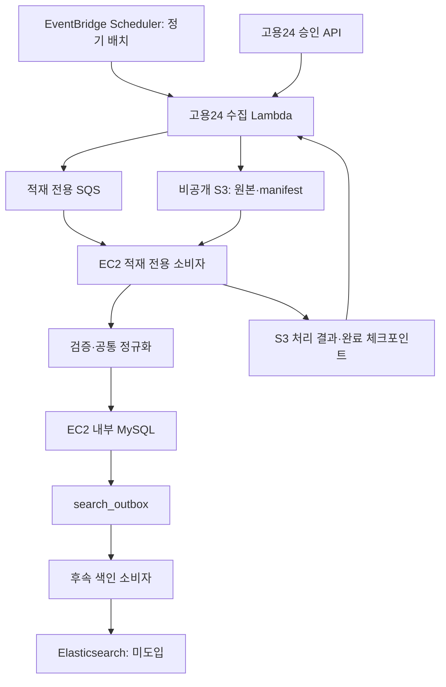

# 고용24 승인 후 소량 검증·AWS 배치 자동화 계획

수정일: 2026-10-28. **향후 구현 계획**이며 고용24 수집 코드·예약 작업·운영 적재가 완료됐다는 의미가 아니다. 이 문서는 현 EC2 MySQL 기반 배치를 이어가는 최신 방향이다.

## 최신 우선순위 보완

사용자가 최종 교육 데이터로 국민내일배움카드 훈련과정과 일정을 지정했다. 아래 채용 수집 계획은 유지하되 교육/학습 루트 작업에서는 [교육 공통 구조·훈련 API 계획](TRAINING_DATA_CONTRACT.md)을 우선한다. 부트텐트는 허락 전 실제 수집하지 않고 가상 데이터로 구조를 준비한다. 채용 API 승인과 훈련 API 승인은 별도로 확인한다.

## 1. 현재 구현과 전환 범위

현재 React/S3/CloudFront → HTTP API/Lambda → 대화용 SQS → EC2 작업 서버 → MySQL/Bedrock 흐름을 사용자 웹 테스트로 확인했다. 기준 DB는 EC2 내부 MySQL이며 RDS가 아니다. 점핏 783건은 기존 스냅샷이고, 추가 10건은 파일 검증·별도 로컬 MySQL 시험 적재를 마쳤으나 운영 반영하지 않았다.

고용24 API 승인이 나면 채용정보 수집부터 시작한다. 공통 테이블·원문 보존·버전·Outbox 원칙은 재사용하지만, 점핏 응답 구조와 하드코딩은 그대로 재사용하지 않는다. 교육/훈련 과정 API는 별도 승인·계약을 확인한 다음 training_offerings 어댑터로 확장한다.

## 2. 단계별 진행 및 통과 기준

| 단계 | 작업 | 통과 기준 |
|---|---|---|
| 0. 승인·명세 확인 | 승인된 API 종류, 목록/상세 응답, 키 전달 방식, 이용 범위, 갱신 조건·호출 제한·페이지 규칙 확인 | 실제 승인 내역과 공식 명세를 기록하고 키는 비밀 설정으로만 관리 |
| 1. 소량 수동 추출 | 우선 승인 API가 허용하는 범위 안에서 최대 10건 표본 수집. 로컬에서 응답 확인 가능 | 목록·상세 ID, 필드, 코드, 날짜, 누락·빈 결과·오류 응답 검증. 전체 건수를 확보했다고 주장하지 않음 |
| 2. 공통 모델 매핑 | 채용 원문을 source=goyong24 기준 공통 형식으로 정규화 | 필드별 출처·정밀도·미제공 사유 기록, 점핏과 같은 ID여도 서로 다른 공고로 보존 |
| 3. 격리 DB 시험 | 신규/동일/변경/오래된 데이터·빈 값·마감·재실행·중간 실패 시험 | 중복 0, 최신 값 보존, 내용 변경 시에만 버전 증가, DB와 Outbox 원자성 확인 |
| 4. AWS 수동 1회 | Lambda로 소량 조회 → 비공개 S3 원본·manifest → 적재 전용 SQS → EC2 적재 소비자 | 로컬 파일 전달 없이 끝까지 처리, 전용 계정·권한·백업/복구 확인 후 표본 반영 및 대조 |
| 5. 정기 배치 자동화 | EventBridge Scheduler 예약, 수집 한도·겹침 구간·진행 상태·실패 처리 추가 | 여러 실행에서 무변경 재실행·중단 후 재개·중복 이벤트·실패 재시도·알림 검증 |
| 6. 검색 인덱스 연결 | Outbox 소비자로 Elasticsearch 갱신 | DB/인덱스 ID·버전·상태 일치 및 역순·부분 실패 검증. 엔진이 없으면 Outbox 적재까지만 완료로 표시 |

승인 전에는 가짜 응답 fixture와 어댑터 인터페이스만 준비할 수 있다. 실제 필드명·페이지 크기·정렬·수정일 필터 지원 여부·등록/마감 기준은 승인 후 명세와 응답으로 확정한다. 미제공 상세를 모델로 만들어 보충하지 않는다.

## 3. 목표 AWS 흐름

- 현 MySQL은 EC2 내부 루프백에 연결돼 있다. 초기 자동화는 Lambda가 직접 DB에 접속하는 대신 EC2 소비자가 로컬 MySQL에 쓰는 방향으로 한다.
- 적재 큐·소비자·실패 큐는 대화 처리와 분리한다. 기존 대화 워커는 새 수집 메시지 계약을 처리하지 못하므로 대화용 큐에 임의로 넣지 않는다.
- Lambda에는 수집 API와 전용 S3 경로·적재 큐에 필요한 권한만 부여한다. EC2 역할에는 적재용 S3 경로·큐 소비·처리 결과 기록 권한을 별도로 검토한다. 기존 역할에 해당 권한이 있다고 가정하지 않는다.
- DB 포트를 공개하거나 Lambda에서 SSM 터널을 열지 않는다. DB 직접 연결·VPC 배치는 추후 별도 비용/네트워크 검토 대상으로 둔다.
- 단일 2GB EC2의 채팅 처리와 적재가 경쟁하지 않도록 배치 크기·소비 동시성을 제한하고 부하를 측정한다. 대량 데이터는 여러 페이지·작업으로 나누며 Lambda 한 번에 전체 수집을 보장하지 않는다.

## 4. 공통 데이터 계약과 수정할 코드

- 기준 식별자: (source, source_id). 고용24 채용은 source=goyong24로 통일하고 원문 공고 ID를 보존한다. 제목·회사명으로 임의 병합하지 않는다.
- 기존 job_postings, search_outbox, 대화·답변 근거·사용량 테이블은 유지한다. 실제 필드 매핑 결과 추가 컬럼이 필요하면 별도 마이그레이션으로 검토한다.
- 직종·지역·학력·경력 코드는 원문 코드와 서비스 정규화 값을 함께 보관한다. 관심 기술·직무와 공고의 필수 요건을 구분한다.
- 현재 incremental_jumpit.py의 manifest source URL, ID 규칙, 정제기, SELECT source=jumpit 등은 점핏 전용이다. 공통 검증/트랜잭션/버전 처리와 출처별 어댑터를 분리해야 한다.
- MySQLJobRepository.search/get에는 점핏 고정 조건과 숫자 ID 가정이 있다. 검색·선택·세션 후보 ID를 source+source_id로 식별하도록 함께 수정한다. source_id만 받는 기존 API도 하위 호환 또는 버전 전환을 설계한다.
- 캐시·근거·선택 공고 검증·색인 문서 ID에도 source를 포함한다. 서로 다른 출처의 같은 ID가 충돌하면 안 된다.
- 날짜만 제공되면 date_only로 보존한다. 관측 시각·API 수정 시각·게시 시각을 혼용하지 않는다. 모집 상태는 출처별 명시적 근거와 날짜 규칙에 따라 처리한다.

## 5. 증분·재시도·운영 규칙

- 수정 시각/기간 조회가 지원되면 직전 성공 구간과 겹치는 조회를 사용한다. 지원하지 않으면 가능한 목록 탐색과 제한적 재확인 정책을 설계한다. ID 크기나 최초 기존 ID 발견만으로 탐색을 종료하지 않는다.
- Lambda가 DB ID 목록을 바로 읽을 수 있다고 가정하지 않는다. S3의 최근 처리 상태는 탐색 보조 정보로 사용하고 최종 중복·변경 판단은 DB에서 수행한다.
- 신규 위주 조회, 마감일이 남은 기존 공고의 분산 재확인, 상시·미확인 공고의 별도 재확인 정책을 둔다. 현재 3/7일 간격은 로컬 점핏 도구의 초깃값이지 고용24 확정 주기가 아니다.
- 원본/manifest를 먼저 저장하고 SQS에는 허용된 S3 객체 참조·배치 ID·해시·어댑터 버전 등 최소 메타데이터만 보낸다. 임의 URL·SQL·실행 지시·API 키를 메시지에 넣지 않는다.
- DB 반영과 Outbox를 같은 트랜잭션에 저장한다. 성공한 DB 반영을 확인한 뒤 완료 체크포인트를 진전시킨다. 파일 수집 성공만으로 적재 완료 처리하지 않는다.
- S3·SQS·DB 사이 전체 원자성은 없으므로 단계별 상태·조정 작업으로 업로드 후 전송 실패, DB 성공 후 응답 실패를 복구한다. 중복 전달과 역순 도착을 정상적인 가능성으로 다룬다.
- 호출 한도·429·타임아웃·빈 결과·비정상 XML/JSON을 구분하고 제한된 재시도와 실패 큐를 둔다. 실패 페이지를 무시한 채 완료 워터마크를 전진시키지 않는다.
- 원본 목록의 일시 누락은 삭제나 마감 확정이 아니다. 정규화 결과의 null/unknown으로 기존 유효 값을 지우지 않는다.
- 로그에는 처리 건수·상태·시간·배치 ID만 기록한다. URL 쿼리/API 키/원문 개인정보가 로그나 manifest에 들어가지 않도록 마스킹한다.
- API 키는 AWS 실행 시 Secrets Manager 등 비밀 저장소에서 가져온다. 프론트엔드·Git·S3 공개 웹 버킷에 저장하지 않는다.
- 서비스 재이용 범위와 승인 조건, 원본 보관 기간, DB 백업·복구 절차, 실행 주기·1회 한도·실패 알림·비용 알림을 운영 전에 확정한다.

## 6. 완료 표현

- 현재: 점핏 파일 기반 증분 검증·미리보기·격리 MySQL 시험 적재 구현.
- 고용24 승인 후 표본 단계: 실제 API 최대 10건의 추출·공통 모델 매핑 검증.
- AWS 수동 1회 완료: 로컬 파일 전달이 없는 배치 연계 확인.
- 자동화 완료: 예약 수집부터 DB 반영·실패 복구·관측까지 사람이 파일을 옮기지 않아도 반복 실행.
- 검색 동기화 완료: 별도 Outbox 소비자가 검색 인덱스까지 반영한 것을 대조 검증한 시점.
