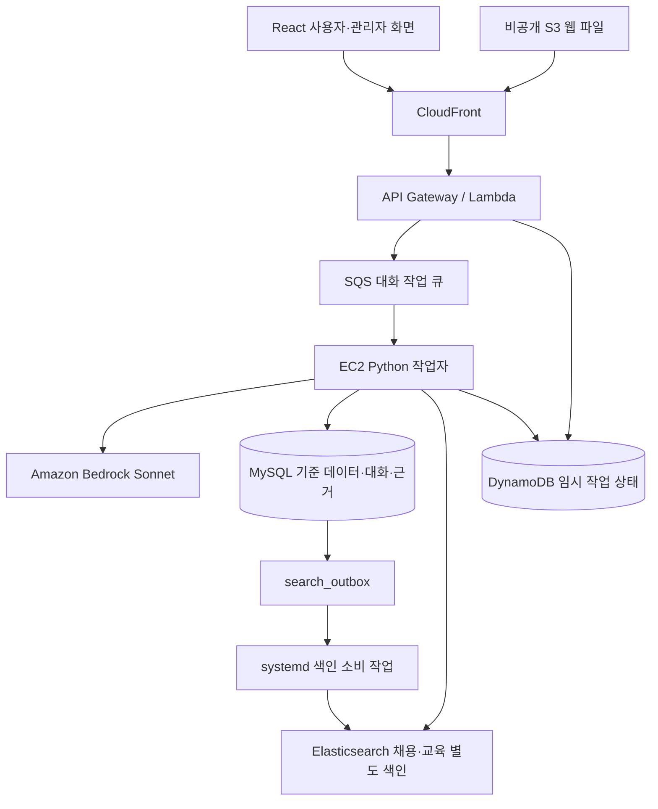

# 현재 시스템 아키텍처

상태: 배포된 구성 기준 · 기준일: 2026-11-02

## 대화 처리

Lambda는 요청 인증·검증과 작업 접수를 담당하고 SQS에 전달한다. EC2 작업자가 대화 실행, 검색 계획 검증, MySQL·Elasticsearch 조회와 Bedrock 호출을 수행한다. 브라우저는 작업 상태를 폴링한다. DynamoDB 임시 작업 상태와 MySQL 영구 대화 기록은 역할이 다르다.

## 데이터 경계

- MySQL: 공고·교육의 기준 데이터, 출처·버전·상태·원문, 세션·메시지·조건 답변·근거·모델 호출·응답 캐시·의도 판정 기록.
- Elasticsearch: MySQL에서 재생성하는 검색 사본. 채용·교육 색인을 분리하며 제목·본문·기술 등의 관련성 검색에 사용한다. 검색 후 MySQL에서 상세·버전·노출 가능 상태를 확인한다.
- Bedrock: 자유 입력의 문맥 의도·검색 계획과 상담 응답 생성. DB·ES를 직접 임의 실행하지 않으며 서버가 계약과 상태를 검증한다.
- S3: 웹 정적 파일과 배포 산출물 등에 사용한다. S3 사용만으로 DB 외부 백업이 확보됐다고 간주하지 않는다.

## 실행 환경과 장애 처리

한 t4g.medium EC2에 MySQL, Elasticsearch, 대화 작업자를 함께 둔다. DB·검색 포트는 외부 공개하지 않는다. Elasticsearch 가용성 장애 시 MySQL 검색으로 복귀하며, 검색 결과가 0건이라는 이유만으로 복귀하지 않는다. 단일 서버 장애는 세 구성요소에 함께 영향을 준다.

## 대화 실행

자유 입력은 ContextRouter에서 Bedrock 문맥 분류 → Pydantic 계약 검증 → 상태별 실행 검증을 거친다. 명시적 버튼·조건 답변·저장 답변 조회/수정은 직접 행동으로 처리할 수 있다. 최근 배포본에는 기존 DialogueFlow의 호환 의도 판정이 남아 있다. 소스에서는 이를 제거한 v3 단일화 구현과 로컬 검증을 마쳤으며 AWS 반영은 아직이다. 변경 계약·검증 범위는 [문맥 판단 단일화](UNIFIED_CONTEXT_ROUTING.md)를 따른다.

검색 기준 확인 → 공고 선택 → 필수조건 문답 → 중간 선택 → 우대조건 또는 상담 흐름을 지원한다. 사용자는 중단·재개·다른 결과·답변 조회/개별 수정이 가능하다. 미확인·미답변을 미충족으로 바꾸거나 합격을 판정하지 않는다. 상세 흐름은 기존 기능 문서를 참조하며 완전한 상태 전이표는 후속 정리 대상이다.

## 색인 동기화

검증된 적재에서 MySQL 데이터 변경과 search_outbox 이벤트를 같은 트랜잭션으로 기록한다. systemd 소비 작업이 DB의 이벤트를 읽고 최신 원본을 ES에 반영한다. 작업 종료 후 약 60초 간격으로 재실행하며 처리·장애 시간에 따라 지연된다. ID·버전으로 중복과 역순 반영을 방어한다. 수동 SQL 변경은 자동 이벤트를 보장하지 않는다. 상세: [검색 동기화](SEARCH_SYNC.md).

## 후속 계획과 한계

고용24 API 수집 자동화는 미완료다. 목표는 예약 수집 → S3 원본 → 적재 전용 큐 → 검증·MySQL/Outbox 적재이며 현재 대화 큐와 구분한다. 추천 이유 A3, 정식 대화 평가, 외부 백업·복원 시험·경보는 각각 완료 증거를 확인해야 한다. 현재 구성과 향후 계획을 혼합하지 않는다.

이전 문서의 누적 변경 이력은 [보관본](history/20261102_before_current_design/ARCHITECTURE.md)에 둔다.
