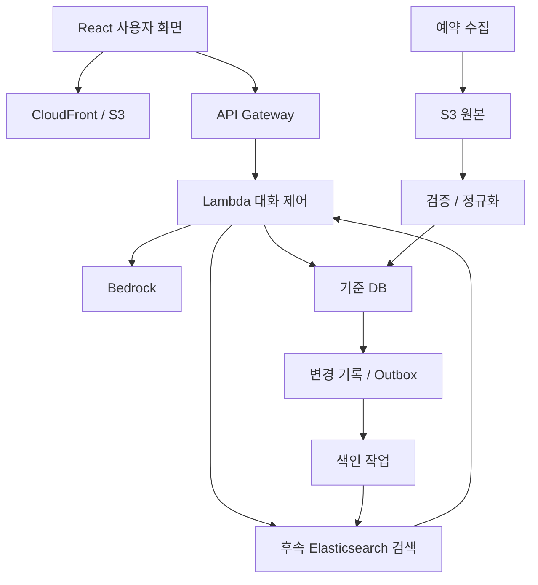

# 아키텍처

## 2026-10-30 검색·추천 근거 후속 설계

백엔드가 명시적 검색 선호·필수/선호 기술 조합을 검증해 검색하고, 실제 표시 후보의 근거를 최종 응답과 연결해 MySQL에 확정하는 경로를 추가한다. 후속 이유 질문은 소유권·만료를 확인해 해당 근거와 관련 발언을 모델 문맥으로 전달한다. 현재 조건 문답 근거 저장과 구분하며 이 경로는 미구현이다.

상세 계약·실제 재현·저장 책임·추가 작업 순서는 [검색 문맥·추천 근거 개선 계획](SEARCH_CONTEXT_EVIDENCE_PLAN.md)을 따른다. 이 추가 절은 후속 설계이며 이번 문서 수정으로 코드·스키마·운영 기능을 변경하지 않았다.

## 2026-10-30 16:38 운영 검색·자동 동기화 연결 완료

채용·교육 검색을 실제 Elasticsearch로 전환하고 기존 EC2에 1분 간격 Outbox 소비 타이머를 설치했다. 원본 공고 942건·교육 7건은 유지하고, 모집 종료/기한 경과 117건을 제외해 검색 색인은 채용 825건·교육 7건이다. Outbox 대기 0건, 타이머 반복 성공, ES green, 대화 작업자 active를 확인했다. React 57건·교육 카드 3건, 주입한 검색 장애의 MySQL 복귀와 다음 요청 ES 재사용도 검증했다. 자동 경보·고용24 수집 자동화·대규모 부하는 별도이며 전체 재색인은 소비 중지 및 변경 경계 보존 절차가 필요하다.

이 상태가 아래 수동 색인/운영 미연결/자동 소비 미구현 설명보다 우선한다. 구현·검증·권한·제한 및 점검 명령은 [검색 동기화 운영 문서](SEARCH_SYNC.md)를 따른다.

## 2026-10-30 현재 적용 상태 (아래 과거 기록보다 우선)

기존 EC2를 t4g.medium(4GiB)으로 확장하고 ARM64 Elasticsearch 9.5.5·Nori를 설치했다. 동일 인스턴스와 EBS를 유지했으며 MySQL 채용 942건·교육 7건을 별도 색인에 반영했다. 엔진 green, 작업자 active, 검색 포트는 127.0.0.1:19200으로 제한한다. 16:09 측정 시 가용 메모리 약 2207MiB이며 부하 시험 결과는 아니다.

운영 챗봇의 검색 경로는 아직 MySQL이다. 최신 연결 코드·검색 선택 설정 적용, 운영 복귀 검증과 Outbox 자동 소비는 남아 있다. 실패 입력 선저장 보완도 로컬 검증 상태이며 운영 앱에는 배포하지 않았다. CloudFormation LaunchTemplate의 기존 t4g.small 설정은 실제 크기와 달라 후속 인프라 변경 전 안전한 정합화가 필요하다.

상세 실행·검증 기록: [AWS 검색 배포 결과](../infra/elasticsearch/DEPLOYMENT_20261030.md). 아래 날짜별 내용은 당시 이력으로 읽는다.

## 2026-10-29 초기 AWS 서버 배치 확정

초기는 기존 EC2를 확장해 MySQL·백엔드 작업자·Elasticsearch를 한 서버에서 함께 운영한다. 신규 검색 전용 EC2는 초기 배포에 추가하지 않는다. 이 결정은 과거의 서버 배치 미정 설명보다 우선한다. 인스턴스 유형·메모리·디스크·월 차액·점검 시간은 아직 미정이며 실제 크기 변경은 실행하지 않았다.

검색 포트는 외부에 공개하지 않고 같은 서버 내부로 연결한다. 검색 읽기/색인 쓰기 권한과 비밀 설정, 영속 볼륨·재시작 정책을 준비한다. 자원 제한으로 DB·작업자에 미치는 영향을 줄인다. 지속적인 메모리 압박/OOM, 검색으로 인한 DB 응답 악화, 색인 지연 또는 독립 배포·복구 필요가 확인되면 검색 전용 EC2 분리를 검토한다. 분리 수치 기준은 관측 후 정하며 정식 부하 검증은 고용24 파이프라인 단계로 이관한 합의를 유지한다.

## 2026-10-29 Elasticsearch 도입 합의와 구현 상태

이 절은 아래 과거 초안의 검색엔진 관련 설명보다 우선한다. **로컬 Nori·동의어 실행과 실제 스냅샷 783건 색인·검색 어댑터 검증을 완료했으며 운영 Elasticsearch는 미도입이다.** 직접 설치 방식으로 진행하며 OpenSearch·Elastic Cloud로 자동 대체하지 않는다. 로컬 Docker에서 분석기·색인·백엔드·동기화를 검증한 뒤 AWS에 배포한다. S3는 원본·백업 저장소이며 검색엔진 설치 위치가 아니다.

현재 배포 경로는 사용자 → CloudFront/API Gateway → Lambda → 대화 SQS → EC2 작업자 → MySQL/Bedrock이다. 검색 도입 후 EC2 작업자가 구조화된 계획을 검증하고 Elasticsearch DSL로 변환한다. Lambda나 MySQL을 새로 대체하지 않는다. Elasticsearch에서 source+ID·버전·점수를 받고 MySQL에서 최신 상태·상세를 확인한다. 원본 데이터와 대화 기록의 기준 저장소는 MySQL이다.

데이터 경로는 검증된 수집 결과 → MySQL+Outbox → 색인 소비자 → Elasticsearch다. 기존 수집용 큐와 대화용 큐는 구분한다. 검색엔진 전용 EC2 추가와 기존 EC2 확장 중 선택은 메모리·지연·비용 측정 후 결정한다.

## 2026-10-28 최신 상태와 고용24 전환 계획

이 절의 실행 현황과 전환 방향을 아래의 과거 초안보다 우선한다. 현재 AWS 웹·대화 서버·EC2 MySQL 연결을 검증했으며 RDS와 Elasticsearch는 사용하지 않는다. 점핏 추가 표본 10건은 백업 후 운영 반영해 총 793건이며, 기존 783건의 버전·해시는 유지했다. 신규 10건의 모집 상태는 unknown이다. **고용24 승인 후 소량 표본 검증을 거쳐 AWS 정기 배치 자동화로 전환**한다. 상세 단계와 통과 기준은 [고용24 파이프라인 계획](../app/ingestion/GOYONG24_PIPELINE.md)을 따른다.

### 수집과 대화 처리 분리

목표 수집 경로는 EventBridge Scheduler → 고용24 수집 Lambda → 비공개 S3 원본·manifest → **적재 전용 SQS** → EC2 적재 소비자 → MySQL+Outbox이다. 대화용 큐·메시지 계약과 분리한다. 현 MySQL에 Lambda가 바로 연결하거나 SSM 터널을 상시 사용하는 구조는 채택하지 않는다. S3 완료 체크포인트는 DB 반영 확인 후 진전시키고, 최종 중복 판단은 DB가 담당한다. Elasticsearch 소비자는 별도 구현이다.

수정일: 2026-10-28. 아래는 목표 구조이다.

## 역할

- Bedrock: 검색 조건 구조화, 근거 기반 질문 및 설명 생성.
- Lambda: 계획 검증, 실제 검색, 세션 상태, 조건 판정 검증, 입력 예산, 출력 근거 확인.
- 기준 DB: 원본 식별자, 최신 정규화 데이터, 조건, 데이터 버전 보관. 제품 미정.
- S3: 수집 원본과 버전 보관. 검색엔진의 대체물이 아니다.
- Elasticsearch: DB에서 재생성 가능한 검색용 복사본. Lambda를 대체하지 않는다.

## 대화 상태

initial → searching → choose_job(필요 시) → checking_required → checking_preferred → recommending.

필수 조건이 미충족이면 gap_guidance로 분기한다. 미확인·답변 거절·조건 충돌은 별도 상태로 유지한다. 사용자가 공고를 바꾸면 해당 공고 기준으로 판정한다. 사용자 진술과 판정 근거를 분리한다.

## 모델 입력

초기 검색에는 프로필 요약과 검색 스키마를 전달한다. 후보 목록은 요약만, 공고 선택 후에는 질문할 섹션과 해당 근거를 전달한다. 전체 대화와 전체 공고를 매번 재전송하지 않는다. 상세 전체 수집과 모델 전체 입력은 구분한다.

## 동기화

DB 변경과 색인 요청 기록을 같은 트랜잭션에 저장하는 Outbox 방식을 기본 후보로 둔다. 전달 작업은 재시도 가능하게 하고, 소비자는 ID·버전으로 중복과 역순 이벤트를 처리한다. DB 확정 후 구현을 정한다. 원본 웹 변경 감지는 정기 수집, DB 이후 전파는 비동기 갱신으로 구분한다.

## 검색 단계

초기는 DB 필터 검색, 후속은 Elasticsearch에서 후보 ID와 점수를 얻고 DB에서 최신 모집 상태·상세를 확인한다. 기존 점수 가중치는 확정하지 않고 평가셋으로 정한다.

## 대화·근거·캐시 저장 보완 (2026-10-28)

Lambda는 대화 상태와 검증된 응답·근거를 DB에 기록한다. 서비스 응답 캐시는 DB에서 먼저 조회하되 소유권·TTL·프로필·상태·데이터 버전을 검사한다. 실제 Bedrock 호출만 호출 이력과 비용에 집계한다. 세부 계약은 ../workspace/database/mysql/CONVERSATION_STORAGE.md를 따른다.

## 2026-10-28 로컬 대화 기억 구현

로컬 구현에 세션 기억을 연결했다. 질문 생성 시 사용자 발언·구조화된 사용자 정보·최근 조건 답변만 한정해 전달한다. 질문과 사용자 정보 추출을 한 번의 Sonnet 호출로 처리하고 원문 인용을 검증한다. 장기 사용자 기억과 새로고침 후 자동 세션 재개는 미구현이다.
