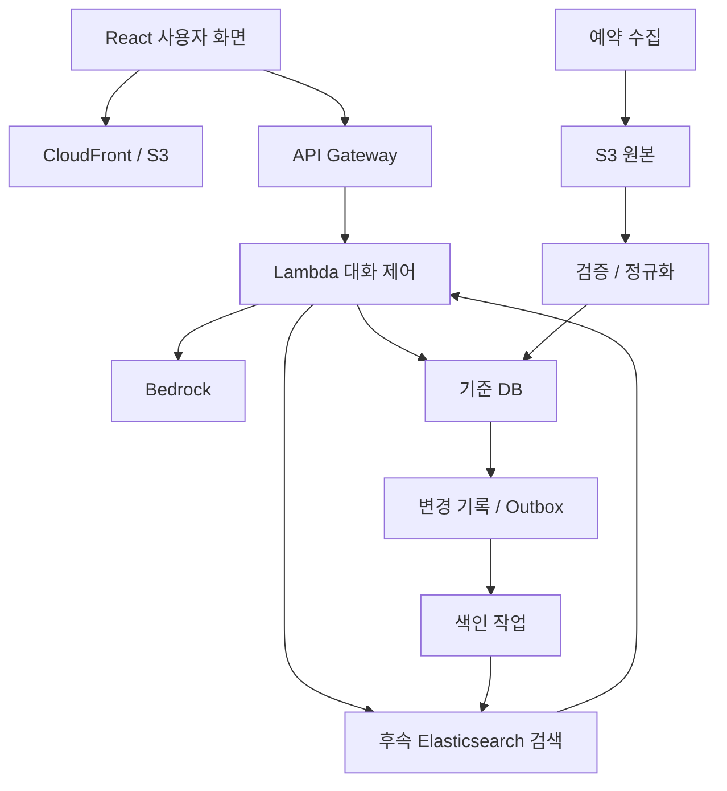

# 아키텍처

수정일: 2026-10-28. 아래는 목표 구조이다.

## 역할

- Bedrock: 검색 조건 구조화, 근거 기반 질문 및 설명 생성.
- Lambda: 계획 검증, 실제 검색, 세션 상태, 조건 판정 검증, 입력 예산, 출력 근거 확인.
- 기준 DB: 원본 식별자, 최신 정규화 데이터, 조건, 데이터 버전 보관. 제품 미정.
- S3: 수집 원본과 버전 보관. 검색엔진의 대체물이 아니다.
- Elasticsearch: DB에서 재생성 가능한 검색용 복사본. Lambda를 대체하지 않는다.

## 대화 상태

initial → searching → choose_job(필요 시) → checking_required → checking_preferred → recommending.

필수 조건이 미충족이면 gap_guidance로 분기한다. 미확인·답변 거절·조건 충돌은 별도 상태로 유지한다. 사용자가 공고를 바꾸면 해당 공고 기준으로 판정한다. 사용자 진술과 판정 근거를 분리한다.

## 모델 입력

초기 검색에는 프로필 요약과 검색 스키마를 전달한다. 후보 목록은 요약만, 공고 선택 후에는 질문할 섹션과 해당 근거를 전달한다. 전체 대화와 전체 공고를 매번 재전송하지 않는다. 상세 전체 수집과 모델 전체 입력은 구분한다.

## 동기화

DB 변경과 색인 요청 기록을 같은 트랜잭션에 저장하는 Outbox 방식을 기본 후보로 둔다. 전달 작업은 재시도 가능하게 하고, 소비자는 ID·버전으로 중복과 역순 이벤트를 처리한다. DB 확정 후 구현을 정한다. 원본 웹 변경 감지는 정기 수집, DB 이후 전파는 비동기 갱신으로 구분한다.

## 검색 단계

초기는 DB 필터 검색, 후속은 Elasticsearch에서 후보 ID와 점수를 얻고 DB에서 최신 모집 상태·상세를 확인한다. 기존 점수 가중치는 확정하지 않고 평가셋으로 정한다.

## 대화·근거·캐시 저장 보완 (2026-10-28)

Lambda는 대화 상태와 검증된 응답·근거를 DB에 기록한다. 서비스 응답 캐시는 DB에서 먼저 조회하되 소유권·TTL·프로필·상태·데이터 버전을 검사한다. 실제 Bedrock 호출만 호출 이력과 비용에 집계한다. 세부 계약은 ../workspace/database/mysql/CONVERSATION_STORAGE.md를 따른다.

## 2026-10-28 로컬 대화 기억 구현

로컬 구현에 세션 기억을 연결했다. 질문 생성 시 사용자 발언·구조화된 사용자 정보·최근 조건 답변만 한정해 전달한다. 질문과 사용자 정보 추출을 한 번의 Sonnet 호출로 처리하고 원문 인용을 검증한다. 장기 사용자 기억과 새로고침 후 자동 세션 재개는 미구현이다.
