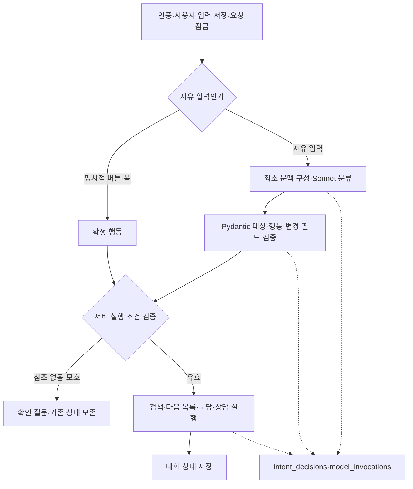

# 문맥·의도 분류 통합 및 디버깅 기록

기준일 2026-11-02. 구현 착수 문서. 운영 반영과 실제 모델 검증은 별도다.

## 방향과 사유

표현별 정규식은 사용자의 다른 표현에 취약하다. 자유 입력을 Sonnet의 단일 의도 분류 진입점으로 모으고, 버튼은 명시 행동으로 직접 실행한다. 모델은 대상·행동·검색 변경값을 제안하며 서버가 허용 상태·소유자·원문 버전·조건 계약을 검증한다. 모호하면 확인하고 상태를 임의 변경하지 않는다. 모델의 내부 사고 과정 대신 짧은 판단 근거만 기록한다.

## 계약

대상 jobs/training/selected/general/unspecified. 행동 chat/search/refine_search/next_results/consult/assessment_control/clarify/confirm_search/summary. 새 검색은 완전한 v2 검색 계획, 수정 검색은 변경 필드만 허용한다. 미지정 필드는 유지하고 빈 배열은 명시 해제로 해석한다. 교육 주제·수강 방식도 구조화해 검색어 정규식에 의존하지 않고 실행한다. 명확하지 않으면 clarify로 반환한다.

## 최소 기록

intent_decisions 테이블 추가: 세션·요청·분류 시도·모델 호출 참조, 핵심 상태 스냅샷, 길이 제한·기본 민감값 마스킹 원본 출력, 검증 결과, 실행 행동·상태·짧은 결과, 계약 버전·생성·만료 시각. 메시지·토큰은 기존 chat_messages/model_invocations를 참조한다. 분류 실패·실행 실패도 기록한다. 실패 로그의 기록은 대화 저장 롤백과 분리한다. 공개 API에 원본 분류 로그를 노출하지 않는다.

## 도입

1. Pydantic 계약·문맥 빌더·Sonnet 분류 어댑터.
2. 기존 실행 기능에 연결하는 서버 라우터, 교육 다음 결과의 중복 제외.
3. 생성 전용 DB 마이그레이션과 기록 어댑터. 운영 DDL은 자동 실행하지 않는다.
4. 기본 꺼짐 CONTEXT_ROUTING_ENABLED 설정. 테이블·권한 적용 후 개발/검증 환경에서 활성화한다. 끄면 기존 경로로 복귀한다.
5. 고정 모의 분류 사례로 문맥별 라우팅·패치 병합·오류/원본 기록 테스트. 실제 Sonnet과 작은 모델 비교는 이후 별도 수행한다.

분류와 상담을 나누면 자유 대화에서 최대 2회 호출이 발생할 수 있다. 모델 제한은 실제 호출 시작의 원자적 카운터에서 유지한다. 비모델 버튼 동작까지 선차단하지 않도록 분리하되 모델 한도 우회는 허용하지 않는다. 교육·공고의 실제 모집 여부는 기존 최신성 정책을 유지한다.

## 로컬 구현 결과

2026-11-02 로컬 구현 완료. 운영 DB 마이그레이션·AWS 배포·실제 Sonnet 호출·커밋/푸시는 수행하지 않았다. CONTEXT_ROUTING_ENABLED는 기본 false이며 운영은 현재 경로를 유지한다.

### 구조

### 코드와 DB

- `src/schemas/intent.py`: 허용 대상·행동, 새 검색 계획과 수정 patch, 필드 혼합·SQL/임의 키 거부. 변경 없는 필드와 중첩 career 선호는 유지하고 빈 배열은 명시 해제로 처리.
- `src/services/intent_context.py`: 단계·주제·마지막 목록·선택 공고 버전·검색 조건·최근 8개 메시지. 전체 공고와 전체 답변을 분류에 반복 전달하지 않는다.
- `src/bedrock/client.py`: classify는 1,536 출력 토큰의 비스트리밍 JSON 분류. 일반 답변은 respond 자연어 스트리밍, 선택 공고 상담은 기존 consult 사용. 분류 JSON은 사용자에게 스트리밍하지 않는다.
- `src/services/context_router.py`: 자유 입력은 기존 정규식/route 분기 전에 단일 분류. 검증된 검색 계획은 별도 execute_search로 실행하며 기존 표현별 재분류를 거치지 않는다. 새/수정 채용 검색은 서버 정책으로 확인받고, 다음 목록은 기존 확인 상태를 유지한다. 구형 경로의 규칙은 설정 해제 시 호환용으로 유지한다.
- `src/repositories/intent_decisions.py`: 소유자·세션 잠금·요청·시도별 독립 기록. 분류 호출 ID를 기존 model_invocations와 연결하고 성공·잘못된 JSON·실행 실패를 구분한다. 실패 시 대화 상태 롤백과 별개로 분류 로그를 보존한다.
- `database/intent_migration.sql`: CREATE TABLE IF NOT EXISTS 기반 추가 마이그레이션. 기존 컬럼 삭제/변경 없음. 새 설치 schema.sql에도 동일 정의 추가.
- `intent_debug_queries.sql`: DBeaver에서 요청/판단/호출·오류를 연결해 읽는 SQL. 관리자 대시보드용 분류 로그 전용 화면은 아직 추가하지 않았다.
- 교육 다음 목록은 source:source_id를 제외하며 ES와 MySQL에서 제외·수강 방식 조건을 결과 제한 전에 적용한다. ES 장애 복귀 시에도 동일 조건 전달. 교육 비교는 저장된 표시 목록을 답변 문맥에 전달한다.
- 웹의 중단·재개·우대 계속·다른 공고·상담 버튼은 명시적 action을 보낸다. 폼의 조건별 답변과 보충 설명은 해당 문답의 명시적 입력으로 저장하며 다시 의도 분류하지 않는다.

### 호출 한도와 기록 범위

검색·다음 목록 자유 입력은 보통 분류 1회, 일반 대화/상담은 분류 후 답변까지 최대 2회다. 기존 12회 한도를 임의 확대하지 않았다. begin_invocation의 원자적 카운터 제한은 유지하고, 요청 수신 단계의 일괄 차단만 제거해 비모델 버튼을 허용한다. 분류 후 답변 호출에서 한도에 도달하면 답변은 실행되지 않고 오류·분류 결과가 남는다. 분류 경로의 요청 잠금은 두 단계 호출을 고려해 180초로 설정했다.

원본 분류 출력은 최대 12,000자, 문맥은 크기 제한과 기본 마스킹을 적용한다. 키·Bearer·비밀번호·이메일·일부 전화번호를 가리지만 모든 개인정보 탐지 보장은 아니다. 원본 사용자 메시지는 기존 대화 저장소에 있고 분류 원문은 제한된 운영 디버깅 자료다. 보관 만료는 세션과 맞추고 session 삭제 cascade 및 cleanup_chat에서 정리한다. 모델 호출 테이블과는 논리 참조를 사용한다.

감사 기록은 대화 저장과 다른 트랜잭션이다. 주 실행은 성공했으나 마지막 감사 기록 갱신이 실패하면 pending/validated 기록과 chat_messages의 성공 기록을 요청 ID로 대조해야 한다. 완전한 원자적 감사/전달을 구현했다고 보지 않는다. 응답의 intent_decision_id는 추적용 ID이며 원본 판단/문맥은 공개 API로 내보내지 않는다.

### 검증과 한계

백엔드 314개 중 303개 통과·격리 DB 환경 의존 11개 제외. 프론트 27개 통과·빌드 성공. 새 검사는 같은 문구의 채용/교육 분기, 모호성 확인, 확인 전 다음 요청, 필드/경력 patch 보존, 문답 중단, 기존 규칙 미진입, 교육 중복 제외·장애 복귀, 마스킹·소유자 잠금, 분류 실패 로그·공개 오류의 원본 미노출을 포함한다.

`app/backend/experiments/context_intent/cases.json`에 합성 QA 21건을 고정했다. 현재는 계약/서버 실행을 모의 분류 결과로 검사한 것으로 Sonnet의 실제 분류 정확도를 측정한 결과가 아니다. 격리 MySQL에서 테이블 생성·실제 로그 보존·한도 이후 비모델 동작을 확인하는 통합 테스트 2건은 준비했지만 이번 환경에서는 실행하지 않았다.

### 다음 적용 순서

1. 격리 MySQL의 career_verify에 schema/추가 마이그레이션을 적용해 선택적 DB 통합 테스트를 실행한다. 운영 DB를 테스트 대상으로 사용하지 않는다.
2. 실제 Sonnet으로 고정 사례의 target/action·조건 변경 보존·오실행·JSON 유효율·지연·토큰을 측정한다. 임의로 유료 호출 opt-in을 켜지 않는다.
3. 운영에 추가 테이블을 적용하고 런타임 계정의 intent_decisions SELECT/INSERT/UPDATE 권한, 정리 계정의 DELETE 권한을 검증한다. 계정·비밀번호는 SQL 파일에 넣지 않는다.
4. 백엔드와 웹을 함께 배포한 뒤 EC2 보호 설정에 CONTEXT_ROUTING_ENABLED를 문자열 true로 넣고 워커를 재시작한다. 테이블 적용 전 활성화하지 않는다.
5. 실제 서비스에서 분류 로그·상담 원문 보존을 확인한다. 문제 시 false로 되돌려 기존 경로를 사용하고 추가 테이블/로그는 보존한다.

소형 모델 교체, 전체 교육 무주제 탐색, 분류 로그 대시보드, 큰 규모의 검색 검증 상한 확장은 이번 범위가 아니다.

## 2026-11-02 실제 분류 오류 수정 및 격리 MySQL 검증

최초 실제 분류는 jobs/search를 올바르게 반환했지만, 모델에 노출한 중첩 SearchPlan 스키마가 구형 keyword 필드까지 포함해 schema_version=2와 keyword가 섞였다. 계약 검증이 이를 차단했고 실패 판단/호출은 운영 intent_decisions에 보존됐다. 원문 반출 없이 필드 자료형·구형 필드의 비어 있지 않음·오류 위치만 조회해 원인을 확인했다. 새 경로는 즉시 비활성화해 기존 방식으로 복귀했다.

수정: IntentJobPlan이라는 v2 전용 모델 경계를 추가해 keyword/region/skills를 스키마에서 제거했다. 허용 필드를 조용히 삭제해 통과시키지 않고 혼합 입력은 계속 거부한다. 실행 직전에 기존 SearchPlan으로 변환한다. 분류 정책·프롬프트 버전은 context-intent-v2로 구분한다.

기존 Docker DB(3308)와 다른 포트 13339의 새 임시 컨테이너에만 스키마와 합성 공고 1건을 넣어 검증했다. 316개 검사 중 314개 통과, 다른 환경 의존 2개 제외. 기존에 제외됐던 MySQL 통합 검사 9건도 실행됐으며, 추가 테이블 생성/실패 기록 보존/재전송/소유자 격리/모델 한도 후 비모델 탐색을 확인했다. 운영 DB의 임시 생성·삭제 검증은 하지 않았다.
