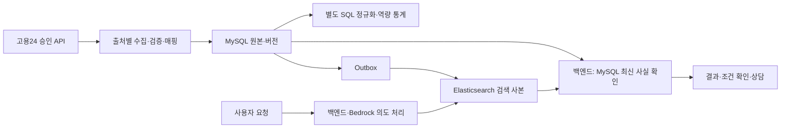

# 검색 역할 결정: MySQL 원본·통계 + Elasticsearch 검색

결정일: 2026-11-02. 고용24 API로 데이터와 직군을 확장하는 방향에서 **기존 Elasticsearch 검색 계층을 유지**한다. MySQL을 대체하거나 검색 실험 후보 설정을 지금 배포하는 결정은 아니다.

## 1. 역할 분담

| 구성 | 역할 |
|---|---|
| MySQL | 공고·교육 원본/정규화 데이터·상태·버전·대화·근거의 기준 저장소 |
| SQL 분석 배치 | 공통 역량 정규화, 기업 요구/훈련 커버리지 집계·통계 |
| Elasticsearch | 재생성 가능한 검색 사본. 한국어 본문·등록 동의어·필드 가중치·검색 후보 조회 |
| Bedrock + 백엔드 | 사용자 의도·선호 해석, 검색 계획 검증/변환, 저장된 원문·답변을 바탕으로 상담 |
| 백엔드 최종 확인 | 검색 후보의 출처·ID·버전·현재 노출/마감 조건을 MySQL에서 확인 |

원본→DB/Outbox→ES의 기존 방향을 유지한다. 사용자가 ES·DB에 직접 접근하지 않는다. Bedrock이 SQL이나 ES에 임의 실행 권한으로 직접 연결되는 구조로 바꾸지 않는다. 통계용 정규화 배치를 실시간 검색 요청마다 실행하지 않는다.

고용24 수집 노드는 향후 목표이며 승인·어댑터·AWS 배치는 미완료다. 기존 점핏 데이터의 DB/Outbox/ES 운영 상태와 구분한다.

## 2. 선택 근거와 반대 근거

- 태그 동의어 80조건×4개군에서 SQL과 ES 결과가 같았다. 동의어 해결만으로 ES 필요성을 주장하지 않는다.
- 본문 실험에서 Nori가 붙여쓰기·조사·중간 단어 표현의 원문 근거를 더 회수한 사례가 있었다. 예: 시계열분석으로 시계열 데이터 분석 원문을 회수.
- ES는 한국어 분석·분야별 사전·여러 필드의 검색/가중치 설정을 관리하며 자유 본문 검색을 확장하는 선택으로 유지한다. 다양한 직군이 들어온다고 자동으로 전문용어를 이해하는 것은 아니다.
- SQL 정규화도 대부분의 고정 표현을 처리했으며 FULLTEXT/검색용 컬럼·색인도 대안이다. SQL로 구현 불가능하거나 ES가 항상 빠르다는 근거는 없다.
- ES는 메모리·색인 저장·동기화·재색인·장애 관리 부담이 있다. 후보가 늘어도 모두 적합하다는 뜻이 아니며 사람 관련성 평가가 필요하다.
- 기존 운영 연결이 있다는 점은 추가 구현 범위 판단에 활용하되 이미 쓴 비용만으로 유지를 정당화하지 않는다.

즉, **필수성이 입증된 기술이 아니라 향후 한국어 본문·순위 요구에 대한 설계 선택**이다. 실제 고용24 데이터의 품질·비용·운영 결과로 계속 검토한다.

## 3. 현재 실험을 인용하는 기준

동의어 실험은 정답 ID 집합 일치 55/80→80/80이며 SQL/ES 동일이었다. 본문 실험은 잠정 원문 표현 규칙의 회수이며 사람 관련성 정확도/전역Recall이 아니다. 사후에 추가한 SQL 정규화 대조군은 미사용 표현·타 분야에서 재검증해야 한다.

본문 실험 관측 중앙값은 정규화 SQL30.90ms, 현재 Nori8.40ms, MySQL ngram4.45ms였으나 반환 결과·실행 시점·방법이 다르고 CPU/동시성 측정이 아니다. CPU가3.7배라거나 ES 운영 처리량이 입증됐다고 사용하지 않는다. 수집 시 준비한 SQL 정규화 컬럼·색인과도 비교한다.

고용24·의료 등 다른 직군으로 기존 점수·실험 분모를 일반화하지 않는다. Nori는 문장 의미·필수/우대·부정문·면허 적합성 판단을 대신하지 않는다. FULLTEXT도 색인이 고정돼 개인별 검색이 불가능한 방식이 아니며 요청별 조건·정렬을 적용할 수 있다.

## 4. 유지 조건과 재검토

1. API 데이터 정합성·출처 충돌·DB/ES 버전·마감 정책 일치.
2. 고용24 분야별 독립 관련성 라벨·미사용 검색 표현에서 누락/무관 후보/순위 확인.
3. SQL 개선안 대비 자원·지연·갱신 비용·운영 복잡도 비교.
4. 검색 장애 시 기존 MySQL 복귀 유지. 정상0건을 장애로 바꾸지 않는다. 운영 포트 공개 없이 내부 접근 유지.
5. 품질 이득이 없거나 동기화/자원/운영 비용이 이득보다 크면 구성·검색 범위를 다시 결정한다. 서버 분리는 관측 결과로 판단하며 이번 문서로 새 서버를 만들지 않는다.

다음 작업은 [남은 과업](REMAINING_TASKS.md), 승인 후 순서는 [고용24 연동·재검증](WORK24_INTEGRATION_AND_SEARCH_VALIDATION.md), 통계 활용은 [역량 수요·훈련 공급](SKILL_DEMAND_TRAINING_STATISTICS_PLAN.md)을 따른다. 이번 문서 작성으로 Git 커밋·푸시·배포·설정 변경·모델 호출을 하지 않았다.
