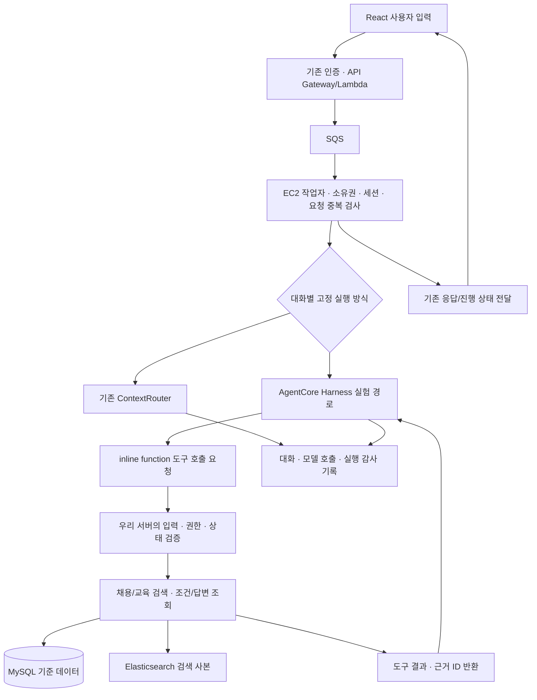

# AgentCore Harness 문맥·도구 실행 전환 계획

상태: 관리자 제한 실험 구현·배포 / 일반 사용자 전환·정식 비교 평가 전
기준일: 2026-11-06

## 목표와 판단 원칙

현재 EC2 작업자의 자유 입력 문맥 분류와 상태별 기능 연결 일부를 Amazon Bedrock AgentCore Harness의 도구 선택으로 대체할 수 있는지 비교한다. 목표는 대화 문맥 품질과 유지보수성 개선이며, 조건식 수나 프롬프트 파일 길이 감소 자체를 성공으로 보지 않는다. 실제 실행·토큰·비용·지연 감소는 측정 전까지 주장하지 않는다.

현재 운영은 Bedrock Sonnet + ContextRouter + Pydantic 계약 + 서버 실행 검증이다. Harness는 별도 관리자 실험 경로에 연결했으며 일반 사용자 기본 경로는 기존 방식이다. [실험 운영 기록](AGENTCORE_EXPERIMENT_RUNBOOK.md)을 따른다. 임베딩·벡터 검색, 전체 AI 조건 백필, 고용24 자동화, MySQL/ES의 서버리스 이전은 이번 실험 범위가 아니다.

## 목표 구조

Harness의 inline function은 도구 스키마를 제공하고 실제 실행은 우리 서버에 반환하는 방식이다. 작업자가 도구 요청을 수신·검증·실행하고 결과를 Harness에 전달하는 제한된 실행 루프를 구현한다. Harness의 도구 요청 이벤트를 실제 업무 실행 성공으로 기록하지 않는다. 반환 제어와 세션을 이어가는 어댑터는 여전히 필요하다.

초기에는 Harness가 EC2 내부 MySQL/ES에 직접 접속하지 않는다. 기존 포트를 공개하거나 Gateway/NAT를 필수로 추가하지 않는다. AgentCore 도입만으로 현재 EC2·MySQL·ES가 서버리스로 바뀌지 않는다.

## 도구 계약 초안

모든 도구의 소유자·세션·request_id는 인증된 서버 문맥에서 주입한다. 모델이 만든 임의 사용자 ID를 조회 권한으로 사용하지 않는다. 입력은 Pydantic으로 검증하고 출력은 필요한 필드·카드 수·문자 수만 반환한다. 임의 SQL/ES DSL·관리자 변경 도구는 제공하지 않는다.

| 도구 | 입력 개념 | 반환/검증 |
|---|---|---|
| search_jobs | 검색 계획, 직접 요청/문답 기준, 필수조건 인용 근거 | search_id, 당시 후보 수, 적용 조건/순위/제한, 공고 버전. 현재 탐색 화면의 조건 적용 정책 유지 |
| show_job_results | search_id | 검색 소유권·화면별 적용 정책·버전 검사 후 카드. 탐색 화면의 자동 적용과 명시 확인 API를 구분하며 모델 호출 자체로 사용자 동의를 만들지 않음 |
| next_job_results | 현재 검색 참조 | 서버에 저장된 노출 ID 제외, 중복 없는 다음 카드 |
| get_job_conditions | 선택 공고 참조 | MySQL 원문·버전·조건 ID, 기존 선택 시 질문 캐시 재사용 |
| get_saved_answers | 현재 대화 또는 선택 공고 범위 | met/unmet/unknown/미답변, 보충 설명, 원문·버전·근거 ID. 조회 범위는 서버 결정 |
| search_training | 학습 주제·방식·현재 부족 조건의 참조 | 교육 출처·일정·모집 상태·신청 후보/참고 자료 구분 |
| set_assessment_preference | 중단/재개 및 현재 사용자 발화 근거 | 명시 요청 검증 후 선호만 갱신. 조건 답변 자체를 생성·수정하지 않음 |

조건 답변 저장·개별 수정·전체 초기화 승인·확인/다음 버튼은 기존 직접 행동 API를 유지한다. 버튼은 의도 분류를 위해 불필요하게 모델을 호출하지 않는다. 전체 대화 조회나 자유 쓰기 도구는 제공하지 않는다.

필수 검색 조건과 자기보고 경험의 구분, 미확인을 미충족으로 처리하지 않기, 마감 제외, 공고 버전 확인, 중복/멱등성과 개인정보 경계는 서버에 남긴다. 질문 필요성 추출 모델과 공유 SQL 캐시는 재사용하고 이번에 전면 재작성하지 않는다.

## 프롬프트 구성

공통 지침에는 역할, 현재 요청 우선, 채용/교육/상담 도구 선택, 기존 답변 우선 조회, 자기보고 한계, 원문 근거, 질문 중단 존중, 경험과 필수 필터 구분, 검색 결과·모집 상태 조작 금지, 교육으로 경력/학위를 대체하지 않기를 둔다. 도구 설명에는 사용 조건·입출력·제약을 배치한다.

현재 프롬프트를 그대로 덧붙이지 않는다. 도구 설명과 시스템 지침 중복을 검토하고, 필요한 문맥은 도구로 제한 조회한다. 도구 스키마·결과·대화 기록도 입력 토큰에 포함되므로 파일 길이와 실제 토큰을 별도 측정한다. 기본 shell·파일 기능 등 업무상 불필요한 실행 능력은 비활성화/차단 가능성을 사전 확인한다. 기대 권한 경계를 보장할 수 없으면 실사용자 실험을 진행하지 않는다.

## 세션과 기록 설계 초안

목표는 일상 대화의 문맥 관리를 AgentCore의 세션·Memory로 옮기고, MySQL에는 사용자가 확정한 문답과 원문·버전·추천 근거를 기준 기록으로 유지하는 것이다. 기존 DB를 디버깅 전용으로 축소하지 않는다. AgentCore 요약·추론은 확정 답변 원문을 대신할 수 없다. 현재 운영은 기존 DB 기반 문맥을 사용하며 이 전환은 설계 합의 단계다. Memory의 서비스 설정·보존 기간·삭제 연동과 실제 효과는 별도 검증 전이다.

| 정보 | 목표 담당 | 기준과 제한 |
|---|---|---|
| 최근 대화·현재 관심 분야·후속 질문 문맥 | AgentCore 세션·Memory | 대화 편의를 위한 정보. 요약으로 확정 문답을 수정하지 않음 |
| 자격요건별 met/unmet/unknown·보충 설명·답변 수정 | MySQL | 사용자 명시 선택의 기준 저장소. 미확인·미답변을 미충족으로 바꾸지 않음 |
| 공고·교육 원문과 버전·조건 식별자 | MySQL | 검색/문답 당시 자료를 추적하고 변경 시 재검증 |
| 추천 근거·검색 조건·결과 참조 | MySQL | “왜 추천했나” 답변은 당시 기록 조회에 근거함 |
| 대화 감사·도구 실행·오류·사용량 | 기존 기록 및 agent_runs/agent_tool_calls 후보 | 디버깅·평가에 사용. 대화 문맥 저장과 중복 계상·보존 범위를 구분 |
| 검색용 문서·분류 조건 사본 | Elasticsearch | 검색 도구가 사용. 확정 문답의 기준 저장소가 아님 |

### 사용자 문답과 도구의 연결

1. 사용자의 자연어 입력은 AgentCore가 현재 문맥과 함께 해석한다.
2. 이미 답변한 경험·부족 역량·추천 근거가 필요하면 get_saved_answers 등 제한된 조회 도구로 MySQL의 해당 사용자·세션 기록을 가져온다.
3. 학습 가능한 기술과 경력·학위 등 대체 불가능 조건을 구분하고, 주제가 불명확하면 먼저 확인한다.
4. search_jobs/search_training 도구로 검색한다. 현재의 검색 코드·ES·MySQL 검증은 재사용한다.
5. AgentCore는 도구 결과의 식별자·원문·버전을 근거로 설명한다. 조회하지 않은 경험·교육 내용을 생성하지 않는다.
6. 조건 문답 팝업의 선택·일괄 저장·수정은 기존 직접 API로 처리한다. 에이전트가 사용자를 대신해 충족 답변을 저장하지 않는다.

스크롤 추가 조회·상세 읽기·답변 버튼은 모델을 거치지 않는다. 현재 목록에서 상담을 이어가며 AgentCore 도입 때문에 별도 큰 상담 페이지나 일반 상담 팝업을 추가하지 않는다. 문답 전용 모달은 유지한다.

### 기존 DB 메모리의 전환

기존 DB 문맥 조립 코드는 비교 실험·기존 세션 지원·복구 경로로 유지한다. 전환된 신규 세션에서는 같은 일상 대화 기억을 두 엔진이 동시에 갱신하거나 서로 덮지 않도록 담당을 고정한다. 확정 문답 조회·저장, 추천 근거, 감사 기록 코드는 계속 운영 기능으로 사용한다. Memory가 오래된 상태를 갖고 있어도 최신 사용자 수정·DB 답변 버전을 우선하며 충돌 시 확인한다. DB 쓰기 실패를 Memory의 기억 성공으로 대신하지 않는다.

Harness 세션/Memory의 actor·사용자·세션 범위는 서버에서 바인딩한다. 로그아웃·만료·삭제 요청이 MySQL과 Memory 각각에 적용되도록 설계하고, 도입 전 보존 정책을 확정한다. 프론트가 Harness 설정·모델·tools·skills·사용자 식별 범위를 덮어쓰지 못하게 한다.

우리 session_id와 Harness runtimeSessionId를 서버에서 매핑한다. 대화별 engine을 고정하고 중간 턴에서 자동 교체하지 않는다. 재시도는 도구 호출 ID와 요청 ID로 중복 실행을 막는다. 오류 후 실제 도구 실행/저장 여부를 확인하기 전 기존 엔진으로 같은 요청을 자동 재실행하지 않는다.

다음 테이블은 후보이며 DDL 확정·생성 전이다.

| 후보 | 주요 필드/역할 |
|---|---|
| agent_runs | run_id, owner_scope, session_id, request_id, attempt_no, engine, harness/session 참조, 설정·모델·데이터 버전, 상태, 시작/완료 시각, 오류, 제공된 사용량과 계측 범위, 지연, expires_at |
| agent_tool_calls | tool_call_id, run_id, provider_tool_use_id, 단계 번호, 도구 이름, 검증/실행 상태, 제한·마스킹한 입력/결과, 검색·공고·답변 근거 참조, 실행 시간, 오류, 멱등 키, expires_at |

기존 model_invocations·intent_decisions와 중복 계상하지 않도록 연결 전략을 확정한다. 내부 모델 호출별 사용량을 관측할 수 없다면 집계 범위와 미측정을 명시하고 0으로 채우지 않는다. 검색 제안/실행 비교는 기존 _search_record와 연결한다. 모델의 비공개 추론 과정 저장을 목표로 하지 않고, 관측 가능한 도구 선택·입력·결과·최종 근거를 저장한다.

관리자에는 엔진/설정 버전, 도구 실행 타임라인, 제안과 실제 실행 조건, 답변/공고 버전 근거, 오류, 비용·지연 계측 범위를 표시한다. 기존 인증·소유권·만료·조회 크기 제한·마스킹을 재사용한다. 실사용자 대화를 공개 평가셋이나 Git에 넣지 않는다.

## 파일 배치 초안

- app/backend/src/agentcore/: 호출 어댑터, 이벤트 수신·반환 제어, 제한된 도구 디스패처.
- app/backend/src/schemas/: 도구 입력/결과와 실행 기록 계약.
- 기존 services/repositories: 업무 검증·DB/ES 동작 재사용.
- app/backend/experiments/agentcore_harness/: 고정 합성 시나리오·평가 실행기·집계 코드. 서비스 코드와 분리.
- infra/agentcore/: 권한·설정·배포·상태 점검 도구. 기존 코드 배포 도구와 역할 구분.
- workspace/evaluation-reports/agentcore_harness/: 실제 결과·추적 자료. 공개 Git 제외.

## 실행 단계와 종료 조건

1. 사전 점검: 서울 기능/모델/계정 권한, SDK/CLI 지원, 생성/호출 계약, 불필요한 내장 도구 통제, 기록/보존 범위, 비용 항목 확인. 리소스 생성과 유료 실험 전 예산 상한 확정.
2. 기준 고정: 현재 배포 엔진과 동일 DB/ES 스냅샷·정책·합성 세션을 준비하고 비교 평가셋/정답을 고정.
3. 도구 분리: 기존 업무 함수를 래핑하고 모의 모델·격리 DB로 권한·상태·중복·부분 실패 검사. 기존 운영 경로 유지.
4. 관리자 실험: 별도 엔진 선택으로 Harness를 연결하고 감사 기록과 관리자 조회 완성. 일반 사용자 기본 경로는 기존 방식.
5. 실제 모델 smoke: 5개 대화 시나리오로 연결·근거·사용량 계측 확인. 정확도/p95의 증거로 발표하지 않음.
6. 비교 평가: 고정 50개 시나리오를 두 경로로 실행하고 실패 유형·도구·최종 답변·지연·비용을 평가. 정식 120건 의도 평가의 대체로 표현하지 않음.
7. 제한 운영: 필수 안전 조건과 합의한 품질/비용 기준 통과 후 새 대화 일부만 전환. 진행 중 대화는 기존 엔진 유지.
8. 정리: 통과 증거와 복귀 경로 확보 후 중복 자유 입력 분류/분기를 제거. 기존 직접 행동·검증은 유지.

상세 평가 계약: [Harness 비교 실험](AGENTCORE_HARNESS_EXPERIMENT.md).

## 참고 및 미확정

2026-11-04 확인한 AWS 지원표에는 서울 Harness 지원이 표시된다. 지역 지원은 해당 교육 계정 권한·모델 사용 가능성을 증명하지 않는다. 제공 단계·계약·리전은 실제 생성 전에 다시 확인한다.

- [AWS Harness와 Runtime 비교](https://docs.aws.amazon.com/bedrock-agentcore/latest/devguide/harness-vs-runtime.html)
- [AWS inline function 도구](https://docs.aws.amazon.com/bedrock-agentcore/latest/devguide/harness-tools.html)
- [AWS 리전 지원](https://docs.aws.amazon.com/bedrock-agentcore/latest/devguide/agentcore-regions.html)
- [AWS 보안·접근 통제](https://docs.aws.amazon.com/bedrock-agentcore/latest/devguide/harness-security.html)

미확정: 실제 계정 권한/모델, 정식 비교 평가의 비용 상한, DDL·보존 기간·사용량 연결, 기능 플래그 이름, 전환 비율. 현재 코드/API에 존재하는 것으로 간주하지 않는다.
