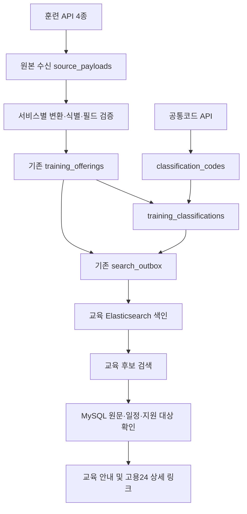

# 고용24 훈련 4종 통합 저장 및 NCS 연결 설계

상태: 통합 저장·NCS는 설계 단계 / 목록 수집·증분 도구 로컬 구현 / DB 마이그레이션·배포 전
기준일: 2026-11-04

## 적용 범위

국민내일배움카드, 사업주훈련, 국가인적자원개발 컨소시엄, 일학습병행을 기존 교육 검색에 통합한다. 구직자 취업역량 강화프로그램은 이번 대상에서 제외한다. 기존 부트텐트 교육은 보존한다. 직업정보·직무정보·기업정보를 교육 과정 행에 섞지 않는다.

목록 각 3건(총 12건)에서 공통 필드 24개를 확인했다. 상세·일정은 서비스별 한 과정씩 확인했다. 사업주·컨소시엄·일학습병행 추가 6요청에서 과정 ID·회차·NCS·일정이 목록과 일치했다. 표본 결과이며 전체 과정의 값 존재를 보장하지 않는다.

## 데이터 흐름

SQL이 원본·공통 정보의 기준이고 ES는 검색용 사본이다. outbox는 사용자 표시용 저장소가 아니라 DB 변경을 검색 사본에 전달하는 작업 목록이다.

## 테이블 구성

신규 제안 3개 + 기존 교육 테이블 확장이다. 실제 DDL은 별도 구현 시 확정한다.

### 1. source_payloads — 원본 수신 (신규)

역할: API 종류와 관계없이 원본 응답 및 변환 근거를 보존한다.

- payload_id: 원본 수신 식별자.
- source/service_code/endpoint_code: 제공처·서비스·목록/상세/일정 구분.
- request_metadata: 과정·회차·기관·페이지 등 비밀을 제거한 조회 조건.
- response_payload 또는 response_object_key: 전체 응답 JSON 또는 원본 파일 위치. 원천 XML을 보관하는 경우 형식도 기록한다.
- payload_hash/schema_fingerprint: 내용 변경 및 스키마 변경 감지.
- http_status/provider_status: 전송 결과와 제공자 오류 구분.
- fetched_at/expires_at: 수집·보관 만료 시각.
- validation_status/validation_errors: 미검증·통과·격리 및 안전한 검증 오류 코드.

API 키·인증 URL·인증 헤더는 저장하지 않는다. 한 원본 응답에 여러 과정이 있으므로 교육 행은 원본 내부 위치도 추적할 수 있어야 한다. 목록·상세·일정의 다중 근거는 기존 additional_sections의 참조 배열로 보존하고 source_payload_id는 대표 원본 연결로 사용한다.

### 2. training_offerings — 공통 교육 (기존 확장)

기존 title/provider_name/source_url/curriculum/eligibility/비용/날짜/상태/원문 추적 필드를 재사용한다.

추가 후보:

| 필드 | 역할 |
|---|---|
| source_service | 훈련 4종 구분 |
| source_course_id | trprId 원문 |
| source_round | trprDegr 문자열 |
| source_institution_id | trainstCstId 원문. 다른 기관 코드와 혼용 금지 |
| source_payload_id | 대표 원본 참조 |

course_key와 source_id 기존 역할을 확인해 중복 저장을 최소화한다. 기존 unique(source, source_id)를 깨지 않고 충돌 없는 외부 식별자를 구성한다. 서비스·과정·회차·기관은 원천 관측 식별 기준이고, 서로 다른 API의 동일 실제 과정은 공식 ID 관계를 검증하기 전 자동 병합하지 않는다. 이름만으로 합치지 않는다.

**NCS 코드·명칭의 기준 저장은 아래 분류 사전과 연결 테이블로 통일한다.** 기존 교육 행에 같은 내용을 필수 컬럼으로 중복 추가하지 않는다. 원본 ncsCd는 raw_detail에 그대로 보존하며 검색 문서에는 연결된 코드·명칭을 복사할 수 있다.

### 3. classification_codes — 공통 분류 사전 (신규)

| 필드 | 역할 |
|---|---|
| classification_id | 내부 식별자 |
| scheme | ncs/keco 등 코드 체계 |
| code/name | 원천 코드 문자열·확인된 명칭 |
| concept_type/level | 직무 분류·능력단위 등의 구분과 계층 수준 |
| parent_id | 같은 체계·버전 내 공식 상위 관계. 미확인은 NULL |
| version | 공식 분류 버전. 수집 날짜를 버전으로 꾸미지 않음 |
| source_payload_id/fetched_at | 출처와 확인 시점 |

코드는 숫자형으로 바꾸지 않고 앞자리 0을 보존한다. 같은 코드라도 체계·개념·버전이 다르면 구분한다. 버전 미제공 시 식별·중복 규칙을 명시하고 MySQL NULL 포함 UNIQUE만으로 중복 방지를 기대하지 않는다. 상위 관계와 사용 여부는 공식 제공값이 있을 때만 채운다.

### 4. training_classifications — 교육과 분류 연결 (신규)

- offering_id/classification_id: 교육과 분류 연결.
- relation_type: 대표 직무 분류 또는 확인된 능력단위 등 구분.
- source_payload_id/evidence_path: API 원문 근거 위치.
- mapping_method/review_status: API 직접 제공·사전 일치·미해결 등 구분.

한 교육에 복수 분류·능력단위 연결이 가능하다. 공식 API의 ncsCd를 공통코드와 대조하고 코드 체계·코드·가능한 버전이 일치할 때 연결한다. 조회한 사전에 코드가 없다고 원본 교육을 버리거나 분류명을 추측하지 않는다. 사전의 하위 코드 조회 범위부터 확인하고 미연결 상태를 유지한다.

## NCS 적용 경계

확인된 교육 NCS를 연결하는 작업과 직업 코드를 NCS로 변환하는 작업은 별개다.

- 지금: 훈련 API ncsCd와 공통코드 NCS를 확인하여 연결.
- 추후: 공식 관계가 확인된 직업·직무 코드와 NCS의 대응 연결.
- 보류: 직업명 유사성만으로 NCS 확정, 부트텐트 제목만으로 공식 NCS 부여.

8자리 NCS 직무 분류, 세부 능력단위, 버전 포함 코드·URI를 구분한다. 분류의 단순 앞자리 절단만으로 공식 계층명을 만들지 않는다. 같은 분류라고 React 교육이나 사용자 역량 충족을 보증하지 않는다.

NCS는 분야 탐색·후보 확장·통계 기준으로 사용한다. 최종 추천은 커리큘럼·확인된 기술·지원 대상·일정·비용 근거와 함께 수행한다. NCS 미연결 과정도 제목·주제로 검색할 수 있어야 한다.

## 날짜·모집·상세 링크

4종 표본에서 확인한 날짜는 훈련 기간이다. 신청 시작·마감일은 별도 확인되지 않았다.

- starts_at/ends_at: 훈련 기간. 날짜만 있으면 기존 계약의 date_only 정밀도 보존 규칙 적용.
- application_start/application_deadline: 별도 근거가 없으면 NULL.
- recruitment_status: 실제 모집 근거가 없으면 unknown.
- source_url: 사용자용 titleLink. API 호출 주소와 구분.

UI 예: 훈련 기간 표시 + '신청 기간·모집 여부는 고용24 또는 교육기관에서 확인' + '고용24에서 상세 내용 확인하기'. 개강 전·정원 미달·종료일 미래만으로 신청 가능을 확정하지 않는다. 4종 모두 titleLink 표본을 확보했고 각 1개 공개 상세 페이지에서 HTTP 200·과정 ID·과정명 일치를 확인했다. 모든 링크가 항상 유효하다는 보증은 아니므로 노출 시에도 원문 안내와 확인 시점을 유지한다.

비용 0을 무료로 단정하지 않는다. 사업주·재직자 대상과 일반 구직자 신청 가능 여부를 구분한다. 필드 부재·빈 값·명시적 0을 보존한다.

## 구현 순서 및 검증 관문

1. 공통코드의 분류 체계·하위 코드 조회·버전 제공 범위 확인.
2. 3개 신규 테이블 및 기존 교육 확장 마이그레이션 작성. 원본·교육·분류 연결의 참조 무결성 정의.
3. 훈련 4종 어댑터 작성. 목록/상세/일정 ID·회차·기관 관계 대조.
4. 격리 DB에서 동일 배치 재처리, 수정 과정 갱신, 다른 회차 구분, 빈 값, 코드 미해결, 기존 교육 보존 검증.
5. 교육/분류 연결과 outbox를 같은 DB 트랜잭션으로 반영. 재전송·순서 역전 시 구버전이 최신 문서를 덮지 않도록 한다.
6. ES에 NCS 코드·명칭·확인된 계층 및 근거 있는 주제 복사. 분류 이름 변경도 관련 교육 재색인 대상으로 한다.
7. 소량 운영 반영 후 검색·원문 링크·날짜·신청 가능 표시·실패 복구 확인. 이후 정기 갱신 연결.

이번 문서는 설계 정리다. 새 API 호출·DDL·AWS 반영·색인은 수행하지 않는다.

대량 수집·증분 실행 절차: [훈련 수집 파이프라인](WORK24_BULK_INCREMENTAL_PIPELINE.md).

관련: [API 조사](WORK24_API_DISCOVERY.md), [교육 데이터 계약](../../app/ingestion/TRAINING_DATA_CONTRACT.md).
검증 자료는 별도 로컬 폴더 C:/AWS_project/고용24_API_검증에 보관하며 실제 응답·비밀 설정은 Git에 넣지 않는다.

## 교육 시작일 기준 검색 노출 정책

일반 교육 탐색은 candidates_only 모드로 조회한다. 시작일이 미래이고 모집 상태가 closed가 아닌 자료만 후보로 읽으며, 시작일 미확인·시작 당일 이후는 제외한다. 날짜만 있으면 한국시간 시작일 00시를 경계로 사용한다. DB의 recruitment_status는 변경하지 않는다.

신청 기간 미확인 과정은 미래 시작일이어도 실제 신청 가능으로 확정하지 않는다. recommendation_eligible는 기존 모집·승인·마감 근거 검증에 시작일 검증까지 추가한다. 모집 미확인 후보에는 경고를 유지한다. 참고 조회 모드는 과거 자료를 계속 읽을 수 있다.

ES 교육 문서에 training_start_at(date)를 저장하고 검색 시 gt now로 필터링한다. 시간이 흐른 것만으로 DB 변경 이벤트가 발생할 필요가 없다. ES 결과는 MySQL 최신 행의 시작일을 다시 확인한다. 원본·과거 대화 근거를 지우지 않고 검색 제외를 사용한다.

배포 전 필수: 기존 교육 색인의 strict mapping에 training_start_at date를 추가하고 전체 교육 문서를 다시 색인한 뒤 검색 코드와 outbox 소비자를 전환한다. 구문서에 필드가 없으면 신청 후보에서 제외되므로 코드만 배포하지 않는다. 현재 운영 색인·AWS는 변경하지 않았다.
