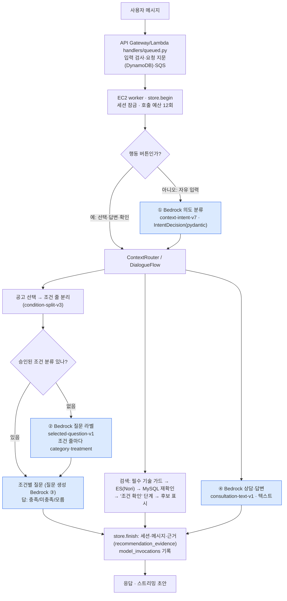
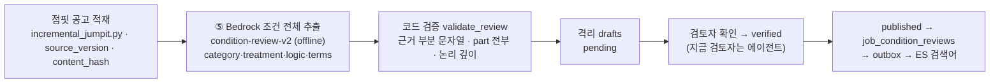
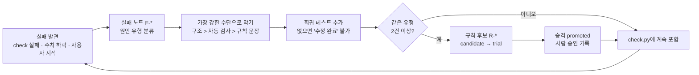

# 검증 전달 문서 — 팀원 AI 에이전트에 검증을 어디에, 어떻게 넣는가

> 이 문서 하나로 팀원이 "검증이 무엇을 막고, 어디에 붙고, 버전이 어떻게 관리되는지"를 따라올 수 있게 쓴다. 발표의 검증·하네스 장(章)도 이 문서를 원본으로 한다.
> 설계와 수치 근거: [[verification]] · 판정 규칙: [[labeling-guide]] · 결정 기록: [[rule-log]]

## 0. 한 문장
**AI가 제안하고, 코드가 검증하고, 사람이 승인한다.** 이 원칙을 세 층에 똑같이 적용한다.

| 층 | AI가 제안 | 코드가 검증 | 사람이 승인 |
|---|---|---|---|
| 서비스 안 | 공고 조건 분류·검색어 추출 | 원문 대조, 스키마, 근거 위조 차단 | 애매한 조건 검토(review) |
| 품질 평가 | 규칙을 넣은 프롬프트 | 블라인드 정답 대비 F1·구간 | 판정 규칙 결정, 정답 봉인 |
| 개발 과정 | 코드·규칙 변경 | `harness/check.py`, 회귀 테스트 | 판단 기록부의 결정자 |

## 검증 지도 (한눈에 · 2026-11-13 사용자와 확정)
기준: 팀원 코드 `career-matching` 83f4970(11/05, GitHub main과 같음) + 팀원 발표 자료(EDUCARE 20장). 11/06 이후 작업(동의어 사전·검색 해석 평가·AgentCore)은 GitHub에 없어 발표 자료로만 확인 — 사용자 결정 "있는 대로 하자". 데이터는 오프라인(점핏 수동 수집·주기 업데이트), 대화 중 Bedrock 호출은 시연에서 그대로 쓴다.

| V | 위치 (워크플로) | 무엇을 막나 | 방식 | 범위 |
|---|---|---|---|---|
| V1 | 데이터 적재 | 같은 공고를 새 번호로 다시 올린 재게시가 따로 세어짐(ID 중복만 막고 있음). 스냅샷 1,154건 중 재게시 사본 **259건(22.4%)**, 수준(경력·직급·학력)만 다른 동시 게시 207건 | 회사·제목·요구 문장 겹침 규칙 + 사람 확인 카드(코드 판단 숨김) 1·2차 → [[v1-reposts]] | **완료 (11/14)** · 묶기 사람 일치 47/49 (0.86~0.99) |
| V3 | 대화 ② 조건 라벨 (`selected-question-v1`) | 조건 줄의 범주(기술·경력·학력·자격증·성향·기타)·처리(물어봄·참고·애매)를 잘못 붙임 → 엉뚱한 질문, 중요한 조건 누락 | 블라인드 정답 20건(조건 228개, `eval/gold.conditions.json`), 범주 정확도·기술 이름 macro F1, B(팀원 프롬프트) vs C(+ 내 규칙). 처리(묻기·참고·검토)는 정답에서 뺌(11/14 사용자 결정) | **완료 (11/17)** · [[v3v4-results]] |
| V4 | 조건 줄 분리(`condition-split-v3`) → ③ 질문 | "학사 **또는** 동등 경력" 같은 대안 관계가 따로따로 필수 질문으로 쪼개짐 (팀원 발표 10·15장이 지목한 문제) | 같은 정답에 관계 표시(쉼표=모두, `\|`=하나만, 모름) — 사람이 읽은 의미 기준. B·C의 AND/OR를 맞음·틀림·보류로 채점 | **완료 (11/17)** · [[v3v4-results]] |
| V4b | 대화 ① 의도 분류 → 검색 계획 | 사용자 요청의 A AND (B OR C)가 우대로 낮아짐 (팀원이 22회 중 4건 확인) | 팀원 22회 평가를 보류 정답셋·구간으로 확장 | 다음 |
| V5 | ES 동의어 사전 | 사전에 쓴 표기로 평가해 효과가 부풀려짐 (팀원 발표 12장이 직접 지적) | 사전에 없던 표기로 만든 보류 평가 | 다음 |
| V6 | 대화 ④ 교육 추천 | 과정명에 없는 기술을 가르친다고 안내, "자료 없음"을 "교육 없음"으로 착각 | 과정 근거(과정명·확인된 커리큘럼) 대조 | 다음 |
| V7 | 대화 ④ 상담 답변 | 저장된 답변·근거에 없는 내용을 말함 | 답변 문장 ↔ 근거 대조, 고정 시나리오 | **완료 (11/17)** · 일상 질문 3종에 친구 챗봇이 이미 잘 답함(필수 기술 96%, 경력 15/15) → [[v7-results]] |
| V8 | 모든 AI 단계 공통 | 프롬프트·정책 버전을 올렸더니 조용히 나빠짐 | 버전마다 같은 정답셋으로 재채점, 떨어지면 보류 | 다음 |

**한 번의 라벨링으로 V3·V4를 같이 만든다**: 공고 20건을 팀원 분리기가 나눈 조건 줄 단위로 보여 주고, 줄마다 범주·처리를 고르고 "또는" 묶음을 표시한다.

## 1. 팀원 에이전트 흐름과 검증 위치
조사: 2026-11-13, `career-matching` 코드·문서 읽기만(수정 없음). 경로는 `app/backend/src` 기준.

### 1-1. 대화 한 턴 (실시간)

파란 칸이 AI(Bedrock Claude Sonnet 4.6, Converse) 호출이다.

### 1-2. 조건 추출 (오프라인 배치)

- **두 길의 차이**: 실시간 ②는 조건 줄의 **범주·처리만** 붙인다(검색어 추출 없음). 오프라인 ⑤는 범주·처리 + **논리식 + 검색어(terms)**까지 뽑고, 사람·에이전트 확인 후 게시한다.

### 1-3. 검증이 들어갈 자리
| 위치 | 지금 있는 검증 | 비어 있는 것 → 내 검증이 채울 것 |
|---|---|---|
| ① 의도 분류 | pydantic 계약, 실패 시 키워드 대체 없음 | 실제 모델 정확도 미측정 (가짜 응답 48건으로 실행 회귀만) |
| ② 질문 라벨 (실시간) | 조건 id 완전성, 범주↔처리 일관성, 캐시 `source_contract_only` | **의미 정확도(범주·처리가 맞나) 정답셋 없음** → **블라인드 정답으로 범주·처리 정확도** |
| ⑤ 조건 전체 추출 (오프라인) | 근거 부분 문자열, terms 원문 일치, 격리 → 확인 → 게시 | **검토자가 에이전트**, 사람 정답 없음 → **블라인드 정답으로 기술 검색어 F1 + 규칙 효과(B vs C)** |
| ④ 상담 답변 | 길이·형식, 선호 후처리 | 답변이 근거에 기대는지(groundedness) 검사 없음 → 후속 과제 |
| 프롬프트·정책 버전 올릴 때 | 가짜 응답 회귀 테스트 | **실제 모델 회귀 관문 없음** → 고정 정답셋으로 버전마다 재채점 |

**이번 발표 범위**: ②와 ⑤의 범주·처리·검색어를 블라인드 정답으로 채점하고, 규칙 파일을 넣었을 때(C)와 뺐을 때(B)를 비교한다. ①·④·버전 관문은 같은 방식으로 넓힐 수 있는 다음 단계로 소개한다.

## 2. 검증 종류
| 종류 | 무엇을 막나 | 누가 | 예 (팀원 · 나) |
|---|---|---|---|
| **형식 검증** | 스키마 위반, 잘린 응답 | 코드 | 팀원: pydantic strict, `stopReason=end_turn` |
| **근거 검증** | 원문에 없는 인용·검색어(지어냄) | 코드 | 팀원: `validate_review`의 부분 문자열 검사 · 나: `verify.py` 근거 문장 대조 (연습 22건 위조 0/261) |
| **상태 검증** | 마감·원문 변경 뒤 낡은 결과 사용 | 코드 | 팀원: `ensure_selectable`, `source_changed_reselect_job`, 해시 키 |
| **의미 검증 (정답 대비)** | 형식은 맞는데 판단이 틀림 (범주·필수 여부·검색어 누락) | 사람 정답 + 코드 채점 | **나: 블라인드 정답 최소 20건, macro/micro F1, 차이의 95% 구간** — 팀원 쪽에 없던 층 |
| **규칙 효과 검증** | 규칙이 정말 도움이 되나 | 같은 정답, 프롬프트만 다르게 | 나: B(팀원 프롬프트) vs C(+ 규칙 파일) |
| **회귀 검증** | 고친 오류가 다시 생김 | 테스트 | 팀원 400여 개 · 나: 실패 노트마다 회귀 테스트 이름 |
| **사람 승인** | 자동으로 정하면 안 되는 판단 | 사람 | 팀원: drafts verified/published · 나: 판단 기록부의 결정자 |

## 3. 버전 관리 — 검증과 오류 수정을 어떻게 추적하나
### 3-1. 팀원 쪽에 이미 있는 것
| 대상 | 버전 | 쓰임 |
|---|---|---|
| 프롬프트·정책 | `context-intent-v7`, `selected-question-v1`, `condition-review-v2`, `consultation-text-v1`, `question-memory-v2` 등 상수 | `model_invocations.prompt_version/policy_version`에 호출마다 기록 |
| 조건 분리 | `condition-split-v3` | `condition_hash` = sha256(분리 버전 + 자격요건 + 우대사항) |
| 원문 | `source_version`, `content_hash` | 내용이 바뀔 때만 버전 증가, ES 버전 = source_version |
| 분류 결과 | (job_id, condition_hash, policy_version) 키 — 덮어쓰지 않음 | 원문·정책이 바뀌면 새 키가 되어 옛 결과는 남고 안 읽힘 |
| 배포 | 릴리스 id `20261103T020923Z` 형식 | 문서에만 기록 |

### 3-2. 내 검증이 더하는 것
| 대상 | 버전·기록 | 규칙 |
|---|---|---|
| 판정 규칙 | [[labeling-guide]] 결정 번호(1~11) + [[rule-log]] 날짜·결정자 | 규칙을 바꾸면 C 프롬프트 내용이 바뀌고, 캐시 키에 프롬프트 전문이 들어가 옛 답을 다시 쓰지 않음 |
| 정답셋 | `eval/gold.test.json` status blank → approved, `sealed_at` | 봉인 뒤 수정 불가(코드로 막음), 한 번만 채점 |
| 표본 | 시드 20261108, 회사당 1건, 본 공고 제외 목록 | 같은 시드면 같은 공고 |
| 채점 결과 | (모델, 프롬프트 라벨 `base` / `base+rules:<해시8>`, 정답 status) 묶음 | 결과마다 어떤 규칙 판으로 냈는지 남김 |
| 오류 수정 | 실패 노트 F-* + 회귀 테스트 + 하네스 버전(CHANGELOG) | 수정 완료 = 회귀 테스트 존재 |

### 3-3. 팀원에게 제안할 연결 (발표 뒤 통합 시)
1. 팀원의 `policy_version`을 올릴 때마다 고정 정답셋으로 **실제 모델 재채점** → 점수가 떨어지면 배포 보류.
2. `model_invocations`에 남는 prompt_version과 채점 결과를 같은 키로 묶어 "어느 버전이 몇 점"을 바로 볼 수 있게.
3. drafts의 verified 단계에서 에이전트 대신(또는 함께) 사람 정답 표본을 일정 비율 섞기.

## 4. 하네스와 자체 피드백 루프 (발표용)

### 4-1. 하네스가 하는 일
| 장치 | 무엇 | 지금 숫자 (2026-11-13) |
|---|---|---|
| `python harness/check.py` | 테스트·파이프라인·평가·기록 문서 검사를 한 번에. 결과를 `logs/metrics.csv`에 쌓음 | 실행 기록 41회 |
| 실패 노트 `docs/failures/F-*.md` | 실패 → **원인 유형** → 수정 → **회귀 테스트 이름** (수정 완료 조건) | 11건 (수정 9 · 열림 2) |
| 원인 유형 `harness/failure_types.md` | 정해진 9가지 중 하나로 분류해야 반복을 셀 수 있음 | wrong-assumption 7 · silent-drop 1 · unverified-done 1 · env-config 1 · unclear-output 1 |
| 규칙 후보 `docs/rules/R-*.md` | 실패에서 일반화한 규칙. candidate → trial → promoted | R-001 후보 · R-002 시험 적용 |
| 결정 `docs/decisions/D-*.md` | 결정과 이유. **제안**과 **채택**을 구분 | D-001~D-012 |
| 판단 기록부 [[rule-log]] | 규칙을 정하거나 바꿀 때 질문·선택지·**결정자**·수치 영향 한 줄 | 약 50줄 |

### 4-2. 피드백 루프

### 4-3. 루프가 실제로 잡은 사례 (발표용 예시)
| 실패 | 무엇이 잘못됐나 | 막은 수단 | 회귀 테스트 |
|---|---|---|---|
| [[F-001]] silent-drop | 부족 기술을 상위 5개로 잘라 Go가 사라짐 | 생략 건수 표시 규칙 R-001 | `test_every_missing_skill_is_returned` |
| [[F-009]] wrong-assumption | "Vue.js"의 ".js"를 JavaScript로 셈 | 별칭 앞 "." 차단 | `test_js_suffix_is_not_javascript` |
| [[F-011]] wrong-assumption | 본문을 복사해 낸 다른 자리("node.js 개발자"/"PHP 개발자")를 한 공고로 합침 | 제목 조건 추가 | `test_same_body_under_different_job_titles_stays_apart` |
| 업무 수준 (2026-11-13) | 승인 안 된 AI 제안(업무 = 별도 수준)이 정답·채점·프롬프트에 확정처럼 쓰임 | 사용자 지적 → 결정 11, "제안" 상태 결정 전수 점검 | 판단 기록부 줄 + 라벨링 화면 테스트 |

- **wrong-assumption이 7건**으로 가장 많다 → 하네스가 "같은 원인 반복, 규칙 강화 검토" 경고를 띄운다. 이것이 루프가 스스로 약점을 드러내는 예다.

### 4-4. 사람 판단을 기록하는 방식
- 규칙을 정할 때마다 [[rule-log]]에 **결정자**를 적는다: 사용자 / AI 제안 → 사용자 승인 / AI 판단(확인 대기).
- 사용자가 "애매하다"고 한 것은 확정하지 않고 대화로 정한다.
- 연습 데이터로 규칙을 다듬고, 시험 데이터는 봉인 후 한 번만 채점한다(규칙이 시험지를 보고 만들어지지 않게).
